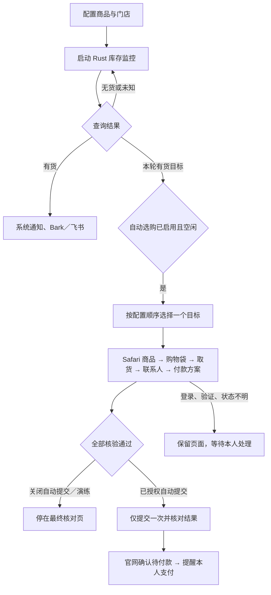

# 拾漏锁单 0.6.2-minute.7：项目逻辑说明

本文描述 0.6.2-minute.7 的静音、轮询、主题和选购逻辑。前端交互、桌面策略、监控与客户端测试已通过；没有进行真实 Apple 订单或付款验证。本文描述代码行为，不保证当前官网选购流程仍可端到端运行。

## 整体设计

这版应用把“Apple 门店库存监控”和“官网自动选购”连接起来：

1. 用户维护想买的商品与门店组合。
2. Rust 后台查询到店取货库存。
3. 有货时提醒用户，并把本轮有货目标交给选购组件。
4. 如果已启用自动选购，Python 选择一个合格目标，操作专属 Safari 标签页。
5. 依次核验商品、购物袋、取货安排、联系人和付款方案。
6. 关闭自动提交时停在最终核对页；开启并确认自动提交后，在满足条件时点击一次下单，核对待付款结果。
7. 登录、验证码、协议及实际付款等需要本人处理。

这里的“锁单”是推进到官网已确认的待支付订单；代码没有实现独立于官网的库存保留机制，也不能从加购成功推断锁单成功。

## 用户配置如何变成执行目标

**监控目标**保存地区、门店编号、商品零件号（SKU）等。iPhone 界面允许多选机型、容量、颜色，再与多家门店组合；只加入商品目录里真实存在的组合，并去重。主流程见 [App.tsx:327](../src/App.tsx#L327)。

**选购方案**保存预算、数量、AppleCare+、付款或分期方案、取货日期、是否清空购物袋、是否自动提交等。大陆命中后，实际机型、颜色、容量和门店由库存目标覆盖；桌面入口把收货方式固定为自提，并清除旧的定时开售设置。见 [worker.py:31](../checkout/worker.py#L31) 和 [worker.py:509](../checkout/worker.py#L509)。

因此，旧选购引擎中还保留的“配送优先”“定时开售”“独立循环监控”能力，不等于当前桌面主链正在使用这些行为。

## 库存监控

- 库存客户端访问各地区的 `/shop/retail/pickup-message` 接口，维护自己的连接、Cookie 和请求调度；这一阶段不靠刷新 Safari 页面。
- 同一门店的多个 SKU 合并查询；有地点信息时进一步合并附近门店查询，响应未覆盖的门店后续单独查询。
- 当前桌面版恢复 **60 秒基础等待间隔**，包括读取旧设置和重新保存设置时。通用引擎中的 30 秒默认值不决定此发行版的节奏。
- 普通等待带 ±20% 抖动，即基础情况下约 48–72 秒；轮询还包含请求执行时间、请求预算等待和故障退避，因此并非严格每分钟拿到一次新结果。
- 默认请求预算容量为 20，每 60 秒恢复一个额度，按出口线路计算；请求之间至少间隔 500 毫秒。目标多、分组多时，预算可能进一步拉长查询间隔。
- 整轮全部失败才触发全局退避，基础间隔最多乘以 8。被拦后另有 5、10、20、30 分钟分档冷却。
- 隧道代理模式（设置页「代理线路」里打开「每次查询换一个出口 IP」，且至少填了一个合法代理）：每次查询新建连接和 Cookie 会话，从新的出口 IP 发出；代理线路不计请求预算，某个 IP 被拦立刻换 IP 重查（最多再换 2 次），不进入分档冷却；本机直连不参与查询。只有这种模式下基础间隔可设为 5–60 秒，其余情况仍固定 60 秒。
- 内部状态保留“有货 / 无货 / 未知”。`pickupDisplay=available` 判为有货，`unavailable/ineligible` 判为无货；解析失败、网络错误等保持未知。

代码入口：[monitor_policy.rs:4](../src-tauri/src/monitor_policy.rs#L4)、[watcher.rs:849](../crates/apw-core/src/watcher.rs#L849)、[apple.rs:270](../crates/apw-core/src/apple.rs#L270)。

本版已注释本地 Sound 通道，并在读取／保存设置时强制关闭本地声音；系统通知和手机推送保持原逻辑。

**提醒和选购使用不同的触发规则。** 到货提醒在状态变为有货时触发，持续有货不反复提醒；重新开始监控后，已有货目标重新查到有货也可再提醒。选购组件则在每轮结束时收到当前有货目标，即使该商品上一轮已经有货。通知发送与选购由 Rust 后台衔接，窗口隐藏后仍可工作。

见 [watcher.rs:995](../crates/apw-core/src/watcher.rs#L995)、[lib.rs:472](../src-tauri/src/lib.rs#L472)。

## 选购如何开始

| 操作 | 代码行为 |
| --- | --- |
| 开始监控 | 启动库存查询；不会替用户开启自动选购。 |
| 启用有货自动选购 | 校验已保存联系资料和进程占用状态，进入等待库存状态；还需要启动监控。 |
| 自动接收有货目标 | 按配置中目标的顺序选择第一个合格项；一旦占用任务，忽略后来的新目标。 |
| 有货行“立即选购” | 使用所选目标与已保存方案；要求库存快照确认为有货，但不套用自动入口的 15 秒时间门槛，进入官网再次核验。 |
| 测试演练 | 不要求已有库存命中；实际打开官网、按设置处理购物袋、选商品和填写资料，禁止最终自动提交。 |
| 停止监控 | 同时请求停止选购。 |
| 停止选购 | 取消当前及排队选购动作，保留官网购物袋和页面。 |

自动入口会两次检查 `lastCheckedMs`：入队前一次，读取联系资料和取得进程锁后再一次，要求该字段距当前不超过 15 秒。这个字段由 Rust 在合并一轮结果时赋值，不是逐个 HTTP 响应的独立完成时刻。

启用选购、执行任务和停止过程中，不能中途修改监控目标或选购方案。每次执行使用方案副本；程序退出重开不会自动重新启用选购。见 [worker.py:434](../checkout/worker.py#L434)、[worker.py:613](../checkout/worker.py#L613)、[checkout_hits.rs:27](../src-tauri/src/checkout_hits.rs#L27)。

## Safari 中具体怎样买

Mac 通过 AppleScript 向专属 Safari 标签页执行 JavaScript。页面脚本读取当前阶段和控件；Python 决定下一步，再让脚本执行一次动作。每次动作会核对页面状态指纹、控件是否仍存在、是否可操作，以及该动作是否已经发送。

主流程是：

1. **核对购物袋。** 开启清空选项时按设置移除已有商品；关闭清空时，只复用完全匹配的单个商品行，否则保留现场等人处理。复用后还会重新检查数量、总价和保障。
2. **选择商品。** 核对机型、颜色、容量、AppleCare+ 和商品价格，确认后加入购物袋。
3. **核对购物袋内容。** 商品、数量、附加项目和包含保障的总预算都要符合方案。
4. **选择自提。** 核对目标门店、省市区、取货日期与可用签到时段。
5. **填写联系人。** 使用已保存资料，并回读官网字段确认；手机号验证等交给本人。
6. **选择付款方案。** 核对全款渠道，或已配置的分期渠道、期数与零费率。选项不能明确匹配时暂停。
7. **核对最终订单。** 再检查逐件配置、数量、门店、日期、联系人核验记录、付款方案和总价。

相关实现：[checkout_service.py:305](../checkout/vendor/checkout_service.py#L305)、[checkout_engine.py:385](../checkout/vendor/checkout_engine.py#L385)、[checkout_browser.js:744](../checkout/vendor/checkout_browser.js#L744)。

**取货日期有三种策略：** 所有型号按指定日期；所有型号选官网最早可取日期；按型号分流——Duo 按指定日期，其余型号最早可取。指定范围内没有可选日期时，不擅自换到范围外。源码默认日期为 2026-10-23、24、25，属于新配置的兜底值，不能据此推断用户实际保存的设置。见 [checkout_engine.py:141](../checkout/vendor/checkout_engine.py#L141)。

## 自动提交与异常处理

自动提交必须同时满足：已开启该选项、本次启用或手动选购时明确确认、订单各项核验通过、没有未核对的上次提交记录。Apple Pay、官网手选，以及仍需人工选择的折抵、保障等方案不能开启自动提交。

点击前先把提交状态写入磁盘；页面脚本只允许经过核验的唯一“立即下单”按钮，并用一次性标识防重复。点击后最多观察 30 秒，只有页面同时显示明确的订单标识、提交成功与待付款信息，才进入“订单待支付”并提醒本人支付。无法确认时保留“结果未知”，禁止自动重试；重启应用后保护仍在，需本人核对订单后明确解除。

见 [worker.py:187](../checkout/worker.py#L187)、[order_guard.py:7](../checkout/order_guard.py#L7)、[checkout_browser.js:747](../checkout/vendor/checkout_browser.js#L747)。

| 遇到的情况 | 主流程如何响应 |
| --- | --- |
| 官网明确无货或超预算 | 自动等待模式下暂避该目标 30 秒，释放当前任务，等待后续库存机会。 |
| 登录、验证码、隐私确认、联系资料验证 | 暂停并提醒本人；部分登录或手机号验证场景会只读观察并在完成后续接原任务。 |
| 页面无法识别、目标不符、操作结果不明 | 保留现场并暂停，不盲目重复加购。 |
| 选购页面明确遭拒绝访问 | 暂停选购，并同步停止库存监控。 |
| 下单结果未知或已待付款 | 保留持久化订单保护，阻止新一轮重复下单。 |

从这些实现可以判断，主要设计取舍是：连续推进可确认的步骤，遇到可能影响购物袋或订单的不确定结果就交回用户，而不是无限重试。

## 模块分工与后续定位

| 层次 | 职责 | 主要文件 |
| --- | --- | --- |
| React / TypeScript | 设置、库存表、状态展示和按钮 | `src/App.tsx`、`src/components/AutoCheckout.tsx`、`src/lib/store.ts` |
| Rust 核心 | 库存接口、查询调度、目录和监控配置 | `crates/apw-core/src/apple.rs`、`watcher.rs`、`catalog.rs`、`config.rs` |
| Tauri 外壳 | 托盘、IPC、通知、将有货目标交给子进程 | `src-tauri/src/lib.rs`、`checkout.rs`、`checkout_hits.rs` |
| Python 任务桥接 | 启用、停止、单任务占用、订单保护和通知状态 | `checkout/worker.py`、`checkout/order_guard.py` |
| Python 选购策略 | 分析页面状态，决定等待、填写、选择或暂停 | `checkout/vendor/checkout_engine.py`、`checkout_service.py` |
| 浏览器适配 | 页面识别、控件定位、实际点击和输入 | `checkout/vendor/checkout_browser.js` |

Rust 与选购子进程通过标准输入输出中的 JSON 消息通信。`vendor/checkout_service.py` 还保留独立服务入口，但这版桌面调用的是 `worker.py`。

Mac 监控设置放在 `~/Library/Application Support/apple-pickup-watcher-auto/settings.v2.json`；选购方案和订单保护放在 `~/Library/Application Support/ApplePickupWatcherAuto/`；联系资料使用 macOS 钥匙串。代码还保留 Windows Edge 和非大陆地区适配；非大陆选购被界面标注为候选适配，付款与最终提交由本人完成。

## 容易被旧文档误导的地方

- 旧版通用文档写的“30 秒、只提醒”不代表当前发行版：当前桌面固定 60 秒基础等待，并接入自动选购和受条件约束的自动提交。
- `worker.py` 顶部仍有“正式提交门槛关闭”的旧注释，但实际执行路径已包含 `submit_once()`；判断能力应看代码中的配置与授权条件。
- 从 `0.6.2-minute.7` 起，尚未轮到的目标显示“待查询”，查询失败显示“未知”，日志和提示区显示具体错误及冷却信息。旧版“调度保护”概括了不同原因，不能单凭这句话确认 HTTP 状态码。被拦截时，客户端首次冷却 5 分钟，探测仍失败才依次延长到 10、20、30 分钟；冷却期间的状态检查不等于发出库存请求。见 [App.tsx](../src/App.tsx)、[apple.rs](../crates/apw-core/src/apple.rs)。
- 监控覆盖的品类比自动选购广；加入监控不等于对应商品已经有可用的浏览器选购适配。
- “测试演练”有真实官网操作；“未提交订单”不等于“购物袋没有变化”。
